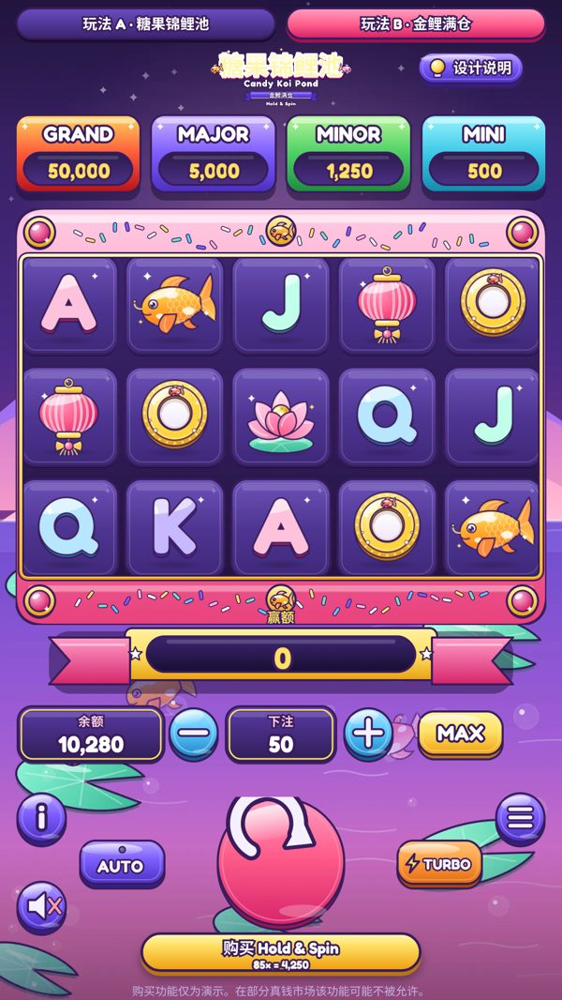
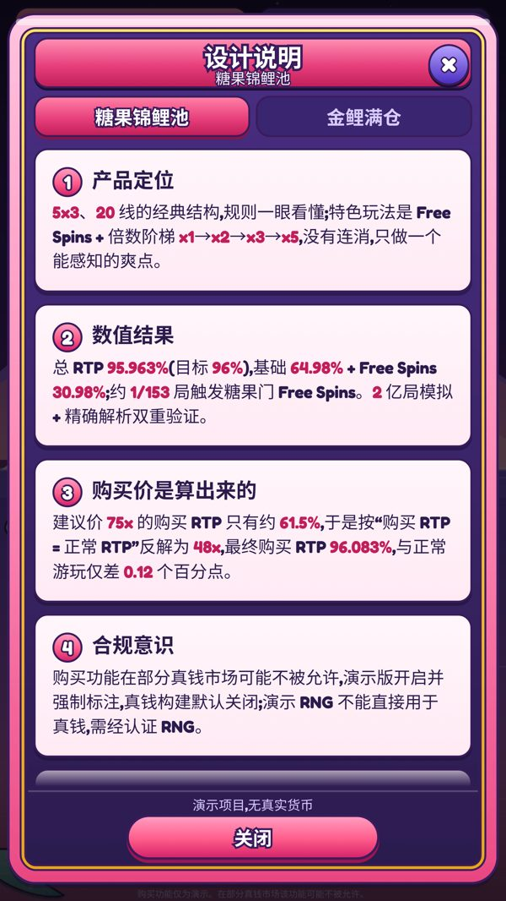
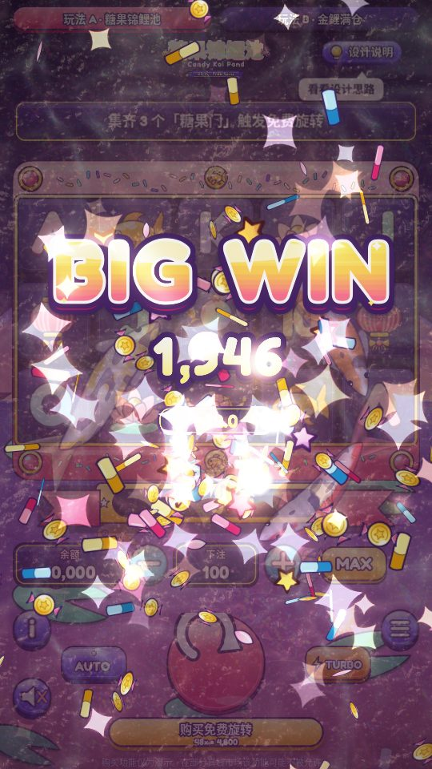
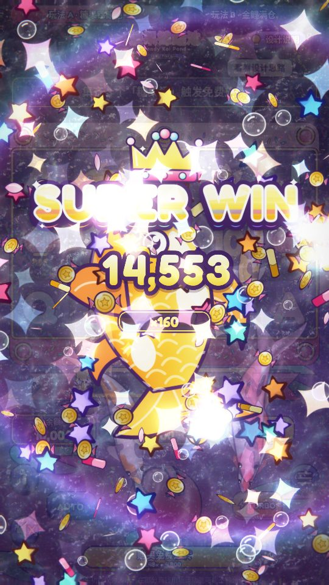
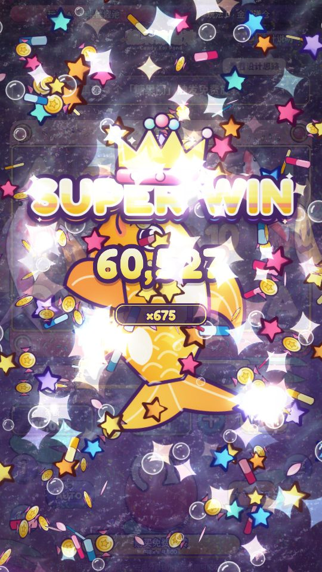

# 糖果锦鲤池 / 金鲤满仓 · Candy Koi Slots Demo

> 一个可交互的双玩法老虎机 Web Demo:**玩法 A《糖果锦鲤池》**(5×3 / 20 线 + Free Spins)与 **玩法 B《金鲤满仓》**(Hold & Spin),附带按档位懒加载的 three.js / shader 大赢演出。PixiJS v8 + TypeScript + Vite。

## 项目定位

这是一个**求职作品集 / 简历 Demo**(面向 Slots 产品经理方向),用来展示:玩法设计 → 数学配置与 RTP 校准 → 产品文档 → 前端实现 → QA 验收的完整链路。

- **演示项目,无真实货币。** 余额是“演示币”,存在浏览器 localStorage,可在菜单里重置。没有充值、提现,也没有任何后端。
- **RNG 仅供演示。** 引擎使用的是普通的可复现伪随机数(便于写测试和 seed 复盘),**不是**经认证的 RNG。若要进入真钱市场,必须换成经认证的 RNG,并由合规实验室做认证与审批;同时“购买特色玩法(Buy Feature)”在部分真钱市场是不允许的。
- **没有线上部署。** 仓库只提供源码,请按下文在本地运行。

## 两个玩法

| | 玩法 A《糖果锦鲤池》 | 玩法 B《金鲤满仓》 |
|---|---|---|
| 结构 | 5×3,20 条固定线,左到右 | 5×3,10 条固定线,左到右 |
| 特色玩法 | Free Spins(3/4/5 个糖果门送 8/12/20 次)+ 连赢倍数阶梯 ×1→×2→×3→×5 | Hold & Spin:≥6 个金币锦鲤触发,锁币 + 重转计数 R=3,四层固定倍数 Jackpot |
| 购买价 | **48×** 总投注 | **85×** 总投注 |
| 规则 / 产品文档 | `slots-design/GameA_*.md` · `slots-product/product_A_*.md` | `slots-design/GameB_*.md` · `slots-product/product_B_*.md` |

## 关键数值

以下数字全部取自仓库内的 `slots-engine/report/RTP_report.md`(及 A/B 分报告),由 2 亿~4 亿局蒙特卡洛模拟 + 精确枚举/解析值交叉检验得到:

| | 正常游玩 RTP | 购买特色玩法 RTP | 购买价 |
|---|---|---|---|
| 玩法 A | **95.963%** | **96.083%** | 48× |
| 玩法 B | **96.023%** | **96.017%** | 85× |

购买价不是拍脑袋:规则文档的建议价(A 75× / B 60×)会让购买 RTP 与正常游玩相差很大,于是按“购买 RTP ≈ 正常 RTP”反解为 48× 和 85×(推导见 `slots-engine/report/RTP_report.md` §5 与 `PAYTABLE_CHANGES.md`)。

## 技术栈

- PixiJS v8(舞台、转轴、符号)+ DOM/CSS 外壳(不使用 React/Vue)
- TypeScript(strict)+ Vite 5 + Vitest 2 + pnpm
- three.js + 自写 shader 的大赢演出(Big / Mega / Super,独立懒加载块,不进首屏;无 WebGL 时回退到 Canvas2D)
- 结果引擎 `slots-engine`:逐步(step)纯函数、零运行时依赖,浏览器本地运行,经 Vite alias 引用

## 仓库结构

> ⚠️ 目录之间是**兄弟关系**,`slots-app` 通过相对路径(`../slots-engine/src`、`../slots-engine/config`、`../slots-spec`)引用引擎与协议类型,请保持整体目录结构不变。

| 目录 | 内容 |
|---|---|
| `slots-app/` | 游戏前端(PixiJS + TS + Vite),含 `public/assets` 已发布素材、`test/`、`scripts/`(e2e、测量、素材脚本) |
| `slots-engine/` | 结果引擎:`src/`、`config/`(赔付表/轴带)、`test/`、`sim/`(模拟汇总)、`report/`(RTP 报告)、`scripts/`(校准/模拟/解析脚本)、`native/enum.c`(穷举解析用 C 源码)、`INTERFACE.md` |
| `slots-spec/` | 引擎 ↔ 前端的协议:`SCAFFOLD.md`、`protocol.ts`、`client.ts` |
| `slots-design/` | 玩法规则文档(A / B) |
| `slots-product/` | 产品页(A / B)与“设计说明”面板文案 |
| `slots-qa/` | QA 报告(仅 Markdown 报告,不含截图/日志) |
| `docs/screenshots/` | README 用的精选截图 |

## 本地运行

需要 Node ≥ 20 与 pnpm。

```bash
cd slots-app
pnpm i              # 建议 pnpm i --frozen-lockfile
pnpm dev            # 开发服务器 http://localhost:5173(带调试开关)

pnpm build          # tsc --noEmit && vite build → dist/
pnpm preview        # 预览 dist/,http://localhost:4173
pnpm typecheck      # 仅类型检查
pnpm test           # vitest(游戏前端用例)
```

引擎自己的测试(可选,需要单独安装依赖,使用 npm lockfile):

```bash
cd slots-engine
npm ci
npm run test:fast   # 跳过耗时较长的 RTP 回归
npm test            # 含 rtp.test.ts,较慢
```

### 调试开关

调试参数**只在 `pnpm dev` 或 `pnpm build:debug` 构建中生效**,普通 `pnpm build` 的产物里不含这些代码。

| 参数 | 作用 |
|---|---|
| `?force=bigwin` | 依次演示 Big / Mega / Super / Max 四档大赢(也可 `?force=big\|mega\|epic\|max` 单档) |
| `?force=fs` / `?force=hs` | 直接进入玩法 A 的 Free Spins / 玩法 B 的 Hold & Spin |
| `?game=A\|B` | 起始玩法 |
| `?seed=xxx` | 指定新存档的 RNG 种子 |
| `?quality=high\|medium\|low` | 强制大赢演出的质量档 |
| `?reset=1` | 清空存档、余额与设置 |

例如:`http://localhost:5173/?force=bigwin`。更多细节见 `slots-app/README.md`。

### 可选:素材脚本(运行游戏不需要)

`slots-app/scripts/copy-assets.py`(`pnpm assets`)是**美术源素材管线**,会从作者机器上的 `/workspace/slots-ui/assets` 复制素材到 `public/assets/`。该美术源目录(约 21MB)**没有放进本仓库**——已发布的素材副本都在 `slots-app/public/assets/`,所以**不需要**运行它。`e2e` / `measure` / `check:panel` / `shoot:*` 等 Playwright 脚本也含 `/workspace/...` 绝对路径或需要 Playwright 浏览器,仅作为验收过程留档,按需改路径使用。

## 截图

| 玩法 A 基础游戏 | 玩法 B 基础游戏 |
|---|---|
|  |  |

| A · Free Spins | B · Hold & Spin | 设计说明面板 |
|---|---|---|
|  |  |  |

大赢演出(three.js + shader):

| Big | Mega | Epic(Super) | Max |
|---|---|---|---|
|  |  |  |  |

> 截图在无 GPU 的软件渲染环境下拍摄,并已缩小压缩。

## 文档索引

| 类型 | 文件 |
|---|---|
| 玩法规则 | [`slots-design/GameA_锦鲤_5轴线赢_FreeSpins.md`](slots-design/GameA_锦鲤_5轴线赢_FreeSpins.md) · [`slots-design/GameB_Hold_and_Spin.md`](slots-design/GameB_Hold_and_Spin.md) |
| 产品页 | [`slots-product/product_A_糖果锦鲤池.md`](slots-product/product_A_糖果锦鲤池.md) · [`slots-product/product_B_金鲤满仓.md`](slots-product/product_B_金鲤满仓.md) · [`slots-product/demo_panel_copy.md`](slots-product/demo_panel_copy.md) |
| 数学 / RTP | [`slots-engine/report/RTP_report.md`](slots-engine/report/RTP_report.md) · [A](slots-engine/report/RTP_report_A.md) · [B](slots-engine/report/RTP_report_B.md) · [`PAYTABLE_CHANGES.md`](slots-engine/report/PAYTABLE_CHANGES.md) |
| 接口 / 协议 | [`slots-engine/INTERFACE.md`](slots-engine/INTERFACE.md) · [`slots-spec/SCAFFOLD.md`](slots-spec/SCAFFOLD.md) |
| QA | [`report.md`](slots-qa/report.md) · [`retest_report.md`](slots-qa/retest_report.md) · [`retest_r3_report.md`](slots-qa/retest_r3_report.md) · [`defects.md`](slots-qa/defects.md) · [`checklist.md`](slots-qa/checklist.md) |
| 前端实现说明 | [`slots-app/README.md`](slots-app/README.md) |

## 已知限制

- **横屏未做**:只有竖屏稿,横屏下仅等比缩放居中,没有 UI 重排。
- **官方赔付表页面是占位**:INFO 打开的是按当前配置渲染的简表。
- **仅在软件渲染下测试**(SwiftShader):没有真机 GPU,iOS Safari / Android / Firefox / WebKit 均未测,大赢演出的真机帧率未知。
- **没有音频**:音频接口已留,但没有音效资源,默认静音。
- 大赢档位阈值为占位值,待策划确认。
- 本仓库的 QA 报告基于上述环境,不代表真机表现。

## 免责声明

本项目仅为作品集演示,不含任何真钱功能,不构成博彩产品。引擎 RNG 仅用于演示;真钱市场需使用经认证的 RNG,并满足当地监管对 RTP、购买特色玩法、负责任博彩等方面的要求。

## 许可

暂未指定许可证(默认保留所有权利)。
